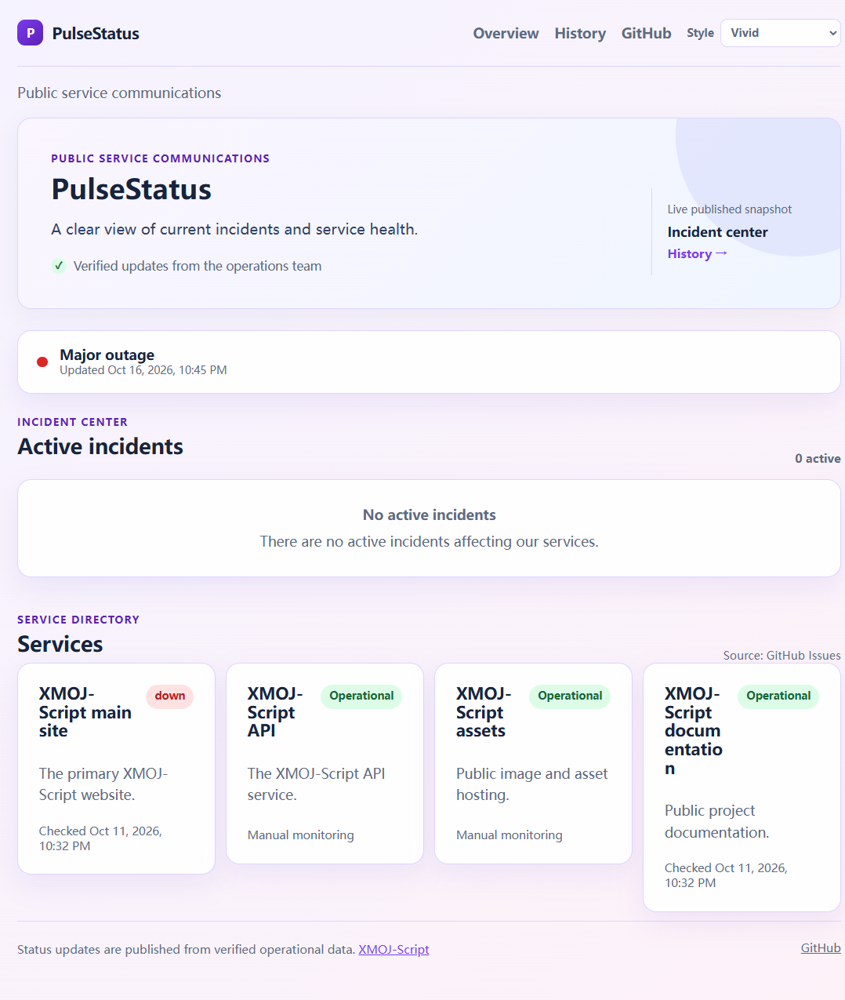
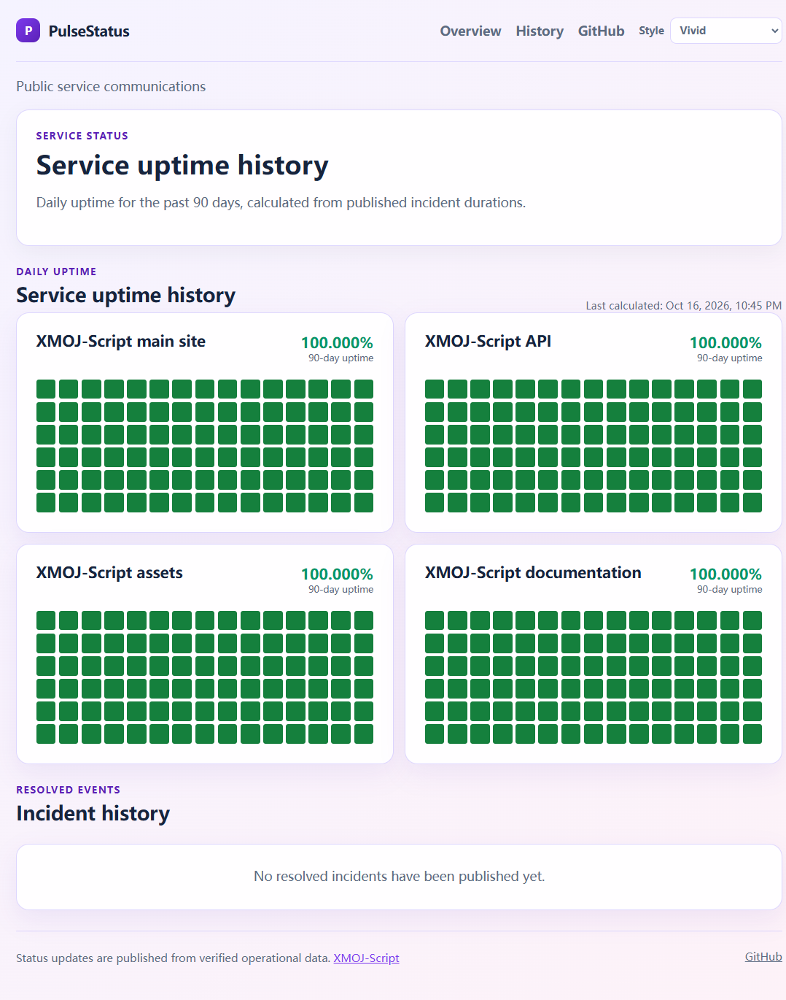
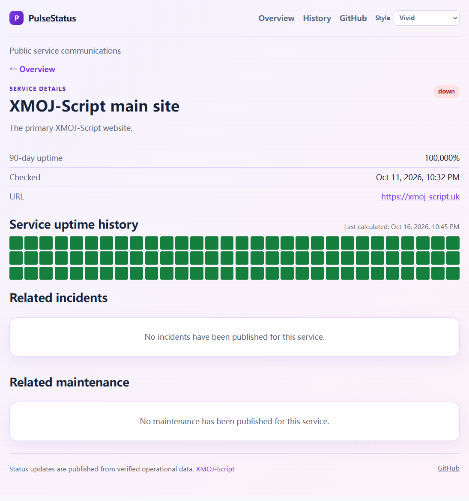

# PulseStatus

> An enterprise-ready, static status and service communications platform for GitHub Pages.

[Use this template](https://github.com/XMOJ-Script-dev/PulseStatus/generate) · [Live example](https://xmoj-script-dev.github.io/PulseStatus/)

PulseStatus turns GitHub Issues into a trustworthy public information center for service status, incidents, planned maintenance, and operational history. It has no server, database, login, or browser-side GitHub token.

## Start from this template

1. Select **Use this template → Create a new repository** and choose your repository name.
2. Edit `config/statuspage.yml` and `config/services.json` with your organization, services, URLs, timezone, and trusted maintainers.
3. Add the labels listed in the administrator checklist below.
4. Enable GitHub Pages with **GitHub Actions** as the source. The first workflow run publishes the site at `https://OWNER.github.io/REPOSITORY/`.
5. Replace the example GitHub link in `src/pages/shared.ts` if your repository is private to the template's example.

The template deliberately starts with an empty, non-demo data snapshot. It never presents fabricated incidents or health metrics.

### Multilingual service directory

Service names and descriptions support locale maps. Keep the plain `name` and `description` as the fallback, then add any locales your audience needs:

```json
{
  "id": "web",
  "name": "Main website",
  "nameI18n": { "en": "Main website", "zh": "主站", "ja": "メインサイト" },
  "description": "The public website.",
  "descriptionI18n": {
    "en": "The public website.",
    "zh": "公开网站。",
    "ja": "公開ウェブサイト。"
  }
}
```

The browser selects the exact locale first, then its base language (for example `zh-CN` → `zh`), and finally falls back to `name` or `description`.

## Local development

```bash
npm ci
npm run typecheck
npm test
npm run build
npm run dev
```

Set `VITE_BASE_PATH=/REPOSITORY/` for a project Pages site. Leave it `/` for a custom domain. The site uses separate HTML pages, so it does not require SPA fallback.

## What visitors see

The screenshots below are generated from the local application with the browser language set to English. They are intentionally kept in the repository so documentation remains reviewable without relying on an external deployment.

### Overview

The overview combines the current system banner, active incidents, and clickable service cards.

The system banner and the incident list are intentionally separate signals. A monitored service can be `down` and therefore make the overall status `Major outage` even when no valid GitHub Incident has been published. In that case the page reports the outage without inventing an incident, and asks maintainers to publish one if a public incident announcement is required.

Automatic incident publication can be enabled for monitored services. After the configured number of consecutive connection failures, the workflow creates a labeled Incident Issue and mentions the configured GitHub users. The generated Issue still requires human confirmation and can be edited with customer impact details. Recovery closes the generated Issue only after the configured number of consecutive successful checks.

The workflow runs every five minutes. Each service has its own probe interval, so a five-minute workflow does not necessarily request every service on every run. The interval can be configured globally and overridden per service.

Services configured with `monitorMode: manual` are never automatically probed. They do not generate connection failures, do not contribute to automatic Incident thresholds, and remain controlled by the published/manual status data. This rule applies even if `checkIntervalMinutes` or a `checkUrl` is present.



### History

The history page presents each configured service's daily uptime and the published incident archive.



### Service details

Selecting a service opens its 90-day uptime view together with incidents and maintenance associated with that service.



Screenshots are documentation assets, not runtime dependencies. Regenerate them after an intentional visual change with a browser configured to use `en-US`; do not commit screenshots containing private incidents, tokens, or customer data.

## Configure the site

The repository is configured from two intentional extension points:

- [`config/statuspage.yml`](config/statuspage.yml) controls the site identity, company information, favicon, published data policy, monitoring, history, and embed settings.
- [`src/styles/custom.css`](src/styles/custom.css) is loaded after the built-in stylesheet on every page. Put organization-specific CSS variables, component overrides, fonts, and responsive rules there.

After changing either file, run `npm run build-data` (for site configuration) and `npm run build` (for the website). The GitHub Actions publishing workflow performs both steps.

The `site` section supports:

```yaml
site:
  name: Example Status
  locale: en
  timezone: Asia/Singapore
  favicon: favicon.png
  companyName: Example Company
  companyUrl: https://example.com
  headerText: Public service communications
  footerText: Status updates are published from verified operational data.
  footerLinks:
    - label: Support
      url: https://example.com/support
```

`favicon` is a path inside `public/`, such as `favicon.png` or `brand/favicon.png`. Keep the file in the repository and use a browser-supported favicon format. All user-visible site text is escaped before rendering; URLs should be HTTPS where possible.

See [`docs/configuration.md`](docs/configuration.md) for the complete configuration reference and [`docs/customization.md`](docs/customization.md) for branding and CSS examples.

## Automation identity

By default, all GitHub API work uses the built-in `github-actions` identity. This includes synchronization, automatic Incident creation and closure, monitor-state commits, and the Pages workflow.

Organizations that want a named bot can optionally install a GitHub App such as `PulseStatusBot`. Set the repository or organization variable `PULSE_BOT_MODE=app`, then store `PULSE_APP_ID` and `PULSE_APP_PRIVATE_KEY` as encrypted Actions Secrets. The workflow uses the App only when all credentials are present; otherwise it falls back to `GITHUB_TOKEN`.

The App needs only repository **Contents: read/write**, **Issues: read/write**, and **Metadata: read-only** permissions. Never put the private key in this repository. See [`docs/github-app.md`](docs/github-app.md) for creation, installation, rotation, and troubleshooting instructions.

## Architecture and data flow

PulseStatus has no application server:

1. GitHub Actions calls the GitHub Issues API with the workflow token.
2. `sync-issues.ts` validates labels, trusted comments, service IDs, incident severity, and maintenance time windows.
3. Monitoring checks optionally update the service snapshot for `scheduled` and `hybrid` services.
4. `build-public-data.ts` derives summary data, monthly incident archives, site configuration, and daily incident-derived uptime.
5. Vite builds the four static entry points: overview, history, incident, and service details.
6. GitHub Pages serves the generated `dist/` directory.

The browser reads only files under `public/data/`. It does not contain a GitHub token and does not call GitHub directly. A failed synchronization must fail the workflow or preserve the previous publication; it must never replace unavailable data with an all-clear state.

### Published data files

| File | Purpose |
| --- | --- |
| `summary.json` | Overall status, active incident count, affected services, and snapshot time. |
| `services.json` | Current service metadata, monitoring result, latency, and last check. |
| `incidents-active.json` | Valid incidents that are currently active. |
| `incidents-all.json` | Active and resolved incidents used by detail pages and uptime calculations. |
| `maintenance.json` | Valid scheduled, in-progress, completed, and cancelled maintenance. |
| `history-index.json` | Monthly index for the incident history page. |
| `history/YYYY-MM.json` | Resolved incidents grouped by their UTC start month. |
| `uptime.json` | 90 UTC days of per-service incident-derived uptime. |
| `site.js` | Site identity and footer/header configuration generated from YAML. |

## Page and URL reference

| Page | URL | Responsibility |
| --- | --- | --- |
| Overview | `/` | Current status, active incidents, service directory, theme selector. |
| History | `/history.html` | All service uptime grids and lazy-loaded monthly incident history. |
| Incident | `/incident.html?number=123` | One incident timeline and its trusted operational updates. |
| Service | `/service.html?id=web` | One service's uptime, incidents, maintenance, status, and public URL. |

The `id` and `number` query parameters are URL-encoded by the application. Service IDs must remain stable after publication because they connect configuration, labels, generated data, and bookmarked detail URLs.

## Release and maintenance workflow

Before merging a configuration, content, or UI change:

```bash
npm ci
npm run validate-config
npm run typecheck
npm test
npm run build
```

For a live data refresh in the Actions environment:

```bash
npm run sync-issues
npm run check-services
npm run build-data
npm run build
```

Inspect the generated `public/data/summary.json`, `public/data/services.json`, and `public/data/uptime.json` before publishing. Timestamps are snapshots, not guarantees that the scheduled workflow ran at an exact minute.

## Troubleshooting

### The page says that data is unavailable

Check that the workflow generated all required files under `public/data/`, that the GitHub Pages artifact contains them, and that the browser network panel does not show a 404 caused by an incorrect `VITE_BASE_PATH`. A project site must be built with `VITE_BASE_PATH=/REPOSITORY/`; a custom domain should use `/`.

### A service is missing incidents or maintenance

Confirm that the Issue has the exact `service/<id>` label from `config/services.json`. Incident Issues also require `statuspage/incident` and exactly one valid severity label. Maintenance Issues require `statuspage/maintenance`, a known service label, and valid `Starts at` and `Ends at` timestamps with an explicit offset.

### Uptime is 100% but monitoring is manual

Uptime is derived from published incident duration, not from an assumption that every minute was probed. A 100% day means no published downtime was recorded for that service. Use the service status and monitoring mode together when communicating availability.

### The favicon or branding did not change

Put the favicon inside `public/`, update `site.favicon`, then run `npm run build-data` before `npm run build`. Browsers cache favicons aggressively; use a new filename or clear the favicon cache when testing.

### Custom CSS is not visible

Edit `src/styles/custom.css`, not `dist/` or generated files. Check selector specificity, confirm the file is included after `main.css`, and inspect all four `data-style` values if the style picker is enabled. Preserve focus outlines and color contrast.

## Publishing data

The Actions workflow performs a full, paginated Issues refresh. It skips invalid incident labels rather than exposing ambiguous events. `statuspage/incident`, one or more known `service/*`, exactly one `severity/minor|major|critical`, and an optional `state/*` label are required. `state/resolved` or a closed Issue removes an incident from the active list and archives it by its UTC start month.

The default configuration is `manual`, so it never probes service URLs. `scheduled` and `hybrid` services may define a `checkUrl` in the service configuration; checks use bounded timeouts and failures do not erase incident data.

### Automatic Incident settings

Configure this behavior in [`config/statuspage.yml`](config/statuspage.yml):

```yaml
monitoring:
  autoPublishIncident: true
  probeIntervalMinutes: 5
  failuresToIncident: 3
  recoverySuccessesToCloseIncident: 2

issues:
  autoIncidentMentions: [PythonSmall-Q]
  autoIncidentSeverity: major
```

- `autoPublishIncident`: set to `false` to disable automatic Issue creation and automatic closing.
- `probeIntervalMinutes`: default interval for scheduled and hybrid service checks, in minutes.
- `monitorMode: manual`: disables automatic probing for that service; `checkIntervalMinutes` is ignored.
- `failuresToIncident`: consecutive failed connection checks required before creating an Incident.
- `recoverySuccessesToCloseIncident`: consecutive successful checks required before closing an automated Incident.
- `autoIncidentMentions`: GitHub usernames to mention in the generated Issue. Use usernames without `@`.
- `autoIncidentSeverity`: `minor`, `major`, or `critical`.

The workflow persists counters in `public/data/monitor-state.json` with a `[skip ci]` commit. The workflow therefore needs `contents: write` and `issues: write` permissions. Do not remove the HTML marker in an automated Issue; it prevents duplicate Issues and lets recovery identify the correct Issue.

To override the default for one service, add `checkIntervalMinutes` to [`config/services.json`](config/services.json):

```json
{
  "id": "web",
  "checkUrl": "https://example.com/health",
  "monitorMode": "scheduled",
  "checkIntervalMinutes": 5
}
```

The GitHub Actions schedule is intentionally five minutes, which is the practical minimum for a standard GitHub-hosted scheduled workflow. Setting a service interval below five minutes cannot increase the actual check frequency; use an external scheduler for sub-five-minute monitoring.

## Service details and historical uptime

Every service card links to `service.html?id=<service-id>`. The detail page includes the current status, public URL, 90-day daily uptime, all incidents linked to the service, and all scheduled maintenance linked to the service. The overview and history pages use the same published static files, so the detail page works on GitHub Pages without a server or API token.

Daily uptime is incident-derived: the builder merges overlapping incident intervals per service, subtracts downtime from each UTC day, and writes [`public/data/uptime.json`](public/data/uptime.json). An open incident extends to snapshot generation time. A day without published downtime is shown as 100%, but this must not be interpreted as probe coverage when the service uses manual monitoring.

## Historical uptime and display styles

The History page shows every configured service's last 90 UTC days. `npm run build-data` writes `public/data/uptime.json` from the published incident data: for each service and day, it subtracts the union of overlapping incident durations from that day's elapsed time. Open incidents are calculated through the time the snapshot is generated. This means the view reports incident-derived uptime rather than inventing probe coverage.

Each daily square is progressively lighter green as uptime falls, then turns yellow and red for significant downtime. Visitors can select Modern, Compact, Vivid, or Monochrome from the header; the choice is retained in their browser.

## Badges and embed

```md


```

```html
<script defer src="https://XMOJ-Script-dev.github.io/PulseStatus/embed.js" data-service="all" data-theme="auto"></script>
```

The embed reads only public static data, uses text content, enforces a 60-second minimum polling interval, and displays a neutral unavailable state when data cannot be fetched.

## Administrator checklist

1. Enable GitHub Pages with **GitHub Actions** as the source and approve the `github-pages` environment.
2. Rename the default branch or update the workflow trigger if it is not `main`.
3. Add the required labels: `statuspage/incident`, `statuspage/maintenance`, `service/web`, `service/api`, `service/assets`, `service/docs`, `severity/minor`, `severity/major`, `severity/critical`, `state/investigating`, `state/identified`, `state/monitoring`, and `state/resolved`.
4. The current service configuration is already set: `web` (`https://xmoj-script.uk`, scheduled), `api` (`https://api.xmoj-script.uk`, manual), `assets` (`https://assets.xmoj-script.uk`, manual), and `docs` (`https://docs.xmoj-script.uk`, scheduled).
5. The repository variable `PULSE_TRUSTED_MAINTAINERS` is already set to `PythonSmall-Q,boomzero,langningchen`.
6. If automatic Issue locking is enabled in a custom workflow, grant only `issues: write` and choose a real GitHub lock reason; this project does not invent `resolved` as a reason for active incidents.
7. Confirm Discussions are enabled only if announcement sync is desired; an unavailable Discussions API does not block Issue incidents.
8. Treat generated timestamps as snapshots. GitHub schedule runs can be delayed, and GitHub Pages cannot provide custom CORS headers.

## Publishing an incident or maintenance

Developers can use **Issues → New issue** and choose **Bug report**, **Incident report**, or **Scheduled maintenance**. A Bug report is only for a defect in this template or its website implementation: it receives the ordinary `bug` label and is never published as a service incident. The Incident and Maintenance forms add their event label automatically and require the operational details needed for review. A maintainer must still verify the content and add the matching `service/*` and `severity/*` labels for an incident before it becomes public. For maintenance, add at least one matching `service/*` label before publication. Maintenance timestamps must include an explicit timezone offset; invalid or incomplete windows are not published as scheduled maintenance. Valid maintenance windows are exported to `maintenance.json` and included in the public summary.

## Limitations

The initial repository data is an explicit empty/unknown snapshot, not demo health. A failed synchronization must fail the workflow or preserve prior published files; it must never publish green status. Public Issue titles, bodies, comments, labels, URLs, and Discussions are untrusted input and are rendered as text.
