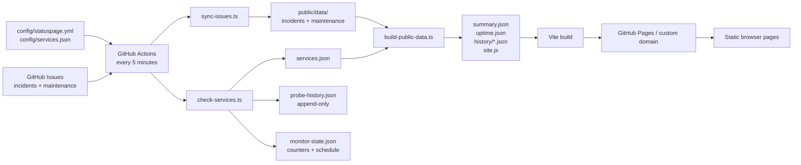
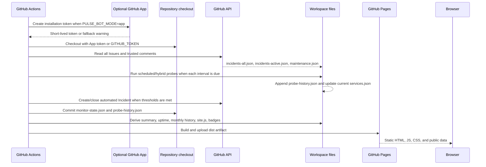
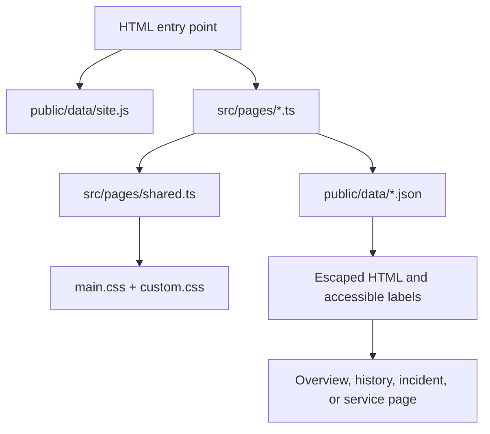

# PulseStatus architecture and runtime logic

This document describes how PulseStatus turns repository configuration, GitHub Issues, scheduled probes, and static assets into a public status site. It is the operational reference for contributors who need to change the data pipeline, monitoring behavior, pages, or GitHub Actions workflow.

## System boundary

PulseStatus is a static GitHub Pages application. There is no application server, database, browser-side GitHub token, login, or runtime GitHub API dependency.



The browser reads only published files. It never has permission to create an Issue, change a service, or write a commit.

## Full workflow sequence

The workflow in [`.github/workflows/statuspage.yml`](../.github/workflows/statuspage.yml) is triggered by pushes, a five-minute schedule, workflow dispatch, and relevant Issue/Discussion events.



### Step-by-step

1. **Select an identity.** The workflow attempts the configured GitHub App only when `PULSE_BOT_MODE=app` and both App secrets exist. A missing installation or invalid credentials produces a warning and falls back to `GITHUB_TOKEN`.
2. **Checkout source.** The selected token is used for repository checkout and later content pushes.
3. **Validate code and configuration.** Type checking, tests, and `validate-config` run before any publication.
4. **Synchronize Issues.** `sync-issues.ts` downloads paginated Issues, rejects invalid labels, keeps only trusted comments, and writes public incident/maintenance snapshots.
5. **Probe services.** `check-services.ts` checks only scheduled or hybrid services with a `checkUrl`, and only when the service-specific interval has elapsed. Manual services are skipped unconditionally.
6. **Publish automated incidents.** `auto-publish-incidents.ts` consumes the current probe result and persisted counters. It creates one marked Issue after the configured failure threshold and closes it after the configured recovery threshold.
7. **Persist monitoring state.** The workflow commits the counter file and append-only probe history with `[skip ci]`, so the state survives the next scheduled run without recursively triggering the workflow.
8. **Build public data.** `build-public-data.ts` derives summary status, incident history, incident-derived uptime, and site branding data.
9. **Configure Pages and build.** `configure-pages` supplies the actual base path. Project Pages use `/PulseStatus/`; a configured custom domain uses `/`.
10. **Deploy.** The Pages artifact is uploaded and deployed. GitHub Pages serves the result without a server process.

## Monitoring state machine

There are two independent state tracks: probe scheduling and incident automation.

```mermaid
stateDiagram-v2
    [*] --> NotDue
    NotDue --> NotDue: workflow runs before checkIntervalMinutes
    NotDue --> ProbeDue: interval elapsed
    ProbeDue --> Operational: HTTP response is OK
    ProbeDue --> Degraded: HTTP response is non-2xx
    ProbeDue --> Down: timeout, DNS, network, or fetch error
    Operational --> NotDue: append result; reset failures
    Degraded --> NotDue: append result; reset failures
    Down --> NotDue: append result; increment failures

    state "Automatic Incident track" as IncidentTrack {
        Healthy --> Failing: real probe fails
        Failing --> Failing: failure count below threshold
        Failing --> IncidentOpen: failure count reaches failuresToIncident
        IncidentOpen --> IncidentOpen: failures continue
        IncidentOpen --> Recovered: real probe succeeds
        Recovered --> Recovered: success count below recovery threshold
        Recovered --> Healthy: success threshold closes marked Issue
    }
```



### Probe scheduling rules

- The Actions schedule is five minutes, but it is not the per-service frequency.
- `monitoring.probeIntervalMinutes` is the default interval.
- `service.checkIntervalMinutes` overrides the default.
- A skipped service reuses its last current result and writes no new probe record.
- A real request appends one record to `public/data/probe-history.json`.
- Manual services never request their `checkUrl`, even if one is present.
- A failed request is a `down` result; a non-2xx response is `degraded`; a successful 2xx response is `operational`.

### Automatic Incident rules

The automation uses an HTML marker such as:

```html
<!-- pulsestatus-auto:web -->
```

The marker makes the Issue discoverable on later runs and prevents duplicate Issues for the same service. The generated Issue is still a normal GitHub Issue: maintainers should verify impact, add operational context, and decide whether its severity is appropriate.

If automatic publication is disabled, counters are still safe to persist, but the automation does not create or automatically close Issues.

## Data contracts and lifecycle

### Source configuration

| Source | Read by | Meaning |
| --- | --- | --- |
| `config/statuspage.yml` | validators, monitor, data builder | Site branding, monitoring defaults, thresholds, labels, and bot behavior. |
| `config/services.json` | validators, monitor, data builder | Stable service IDs, URLs, display text, monitoring mode, and interval overrides. |
| GitHub Issue labels | `sync-issues.ts` | Publication authorization, service association, severity, and incident state. |

### Mutable current snapshots

These files describe the current run and can be regenerated:

| File | Producer | Meaning |
| --- | --- | --- |
| `public/data/services.json` | `check-services.ts` | Current status and last completed probe for each service. |
| `public/data/summary.json` | `build-public-data.ts` | Overall current status and counts. |
| `public/data/summary.js` | `build-public-data.ts` | JavaScript fallback containing the current summary. |
| `public/data/incidents-active.json` | `sync-issues.ts` | Valid active incidents only. |
| `public/data/incidents-all.json` | `sync-issues.ts` | Valid active and resolved incidents. |
| `public/data/maintenance.json` | `sync-issues.ts` | Valid maintenance events and states. |
| `public/data/site.js` | `build-public-data.ts` | Sanitized site identity and branding configuration. |

### Append-oriented and historical data

| File | Write behavior | Meaning |
| --- | --- | --- |
| `public/data/probe-history.json` | Append one record per real probe | Immutable scheduled/hybrid probe results. |
| `public/data/monitor-state.json` | Update counters and last-probe metadata | Operational cursor used to determine due probes and Incident thresholds. |
| `public/data/uptime.json` | Regenerated snapshot | Incident-derived daily uptime for the configured history window. |
| `public/data/history-index.json` | Regenerated index | Monthly incident archive index. |
| `public/data/history/YYYY-MM.json` | Generated monthly files | Resolved incidents grouped by UTC start month. |

Probe history and incident-derived uptime are deliberately different:

- **Probe history** answers: “What did an actual scheduled request observe?”
- **Incident uptime** answers: “How much published Incident downtime overlapped each UTC day?”

A manual service can have no probe records and still have incident-derived uptime data. A day with 100% incident uptime means no published downtime, not proof that every minute was probed.

## Frontend routing and rendering



| URL | Entry file | Main data |
| --- | --- | --- |
| `/` | `index.html` → `src/pages/overview.ts` | summary, active incidents, services |
| `/history.html` | `history.html` → `src/pages/history.ts` | uptime, services, monthly history |
| `/incident.html?number=123` | `incident.html` → `src/pages/incident.ts` | all incidents |
| `/service.html?id=web` | `service.html` → `src/pages/service.ts` | service, uptime, probe history, incidents, maintenance |

`src/pages/shared.ts` owns the common header, administrator-selected theme, footer, date formatting, status cards, service links, and configured favicon. `escapeHtml` is used for public Issue and configuration text before it reaches the DOM.

## Repository file map

The following list covers every project-owned source, configuration, page, data, and documentation file. Dependencies under `node_modules/` and generated build output under `dist/` are intentionally excluded.

### Root files

| File | Role and logic |
| --- | --- |
| `package.json` | Defines the package metadata and all development, validation, synchronization, monitoring, data-build, badge, and test commands. |
| `tsconfig.json` | TypeScript compiler settings for source, scripts, and tests. |
| `vite.config.ts` | Declares the four static HTML entry points and reads `VITE_BASE_PATH` for project Pages or custom domains. |
| `index.html` | Overview document shell; loads site branding data and the overview module. |
| `history.html` | History document shell; loads site branding data and the history module. |
| `incident.html` | Incident detail document shell; loads site branding data and the incident module. |
| `service.html` | Service detail document shell; loads site branding data and the service module. |
| `README.md` | User-facing setup, configuration, screenshots, publishing, troubleshooting, and operational identity guide. |
| `.gitignore` | Excludes local dependencies, build output, and developer-only artifacts from commits. |

### Configuration

| File | Role and logic |
| --- | --- |
| `config/statuspage.yml` | Central YAML configuration for site identity, favicon, company/footer text, monitoring defaults, automatic Incident policy, trusted maintainers, history, and embed settings. |
| `config/services.json` | Service registry. Stable IDs connect display cards, Issue labels, probe history, uptime, and service detail URLs. |

### GitHub automation

| File | Role and logic |
| --- | --- |
| `.github/workflows/statuspage.yml` | Orchestrates validation, optional App token creation, Issue synchronization, service probing, automatic Incident operations, state commits, Pages base-path detection, build, and deployment. |
| `.github/ISSUE_TEMPLATE/incident-report.yml` | Structured form for maintainers to publish a confirmed service Incident. |
| `.github/ISSUE_TEMPLATE/scheduled-maintenance.yml` | Structured form for scheduled maintenance windows. |
| `.github/ISSUE_TEMPLATE/bug-report.yml` | Ordinary repository bug form; it is not published as a service Incident. |

### Runtime source

| File | Role and logic |
| --- | --- |
| `src/types/status.ts` | Shared contracts for incidents, services, summaries, maintenance, site configuration, monitor state, probe results, and uptime. |
| `src/i18n.ts` | English/Chinese strings, locale selection, and status label translation. |
| `src/utils/status.ts` | Incident sorting, monthly grouping, overall status derivation, summary construction, daily uptime calculation, and HTML escaping. |
| `src/data/issues.ts` | GitHub Issue label validation, active-state calculation, safe summaries, trusted comment filtering, timeline construction, and Incident conversion. |
| `src/data/maintenance.ts` | Maintenance timestamp parsing, time-window state calculation, and Issue conversion. |
| `src/data/monitor.ts` | Pure monitoring threshold transition logic used by tests and monitoring behavior. |
| `src/pages/shared.ts` | Shared layout, configured branding, navigation, styles, date formatting, service cards, incident cards, and status classes. |
| `src/pages/overview.ts` | Loads current summary, incidents, and services; renders the status banner and service directory. |
| `src/pages/history.ts` | Loads uptime and lazy-loads monthly incident archives. |
| `src/pages/incident.ts` | Finds one published incident by query-string number and renders its timeline. |
| `src/pages/service.ts` | Finds one service by ID and renders uptime, probe history, related incidents, and maintenance. |
| `src/styles/main.css` | Built-in responsive layout, component styles, semantic status colors, themes, and accessibility states. |
| `src/styles/custom.css` | Repository-owned CSS override layer loaded after the built-in stylesheet. |
| `src/vite-env.d.ts` | Vite types and the global `window.PulseStatusConfig` declaration. |

### Build and synchronization scripts

| File | Role and logic |
| --- | --- |
| `scripts/validate-config.ts` | Validates required site, monitoring, history, automatic Incident, username, severity, and interval settings before publication. |
| `scripts/sync-issues.ts` | Calls GitHub’s paginated Issues and comments APIs, converts valid records, and writes incident/maintenance snapshots. |
| `scripts/check-services.ts` | Applies per-service scheduling, performs bounded fetches, writes current service status, and appends real probe results. |
| `scripts/auto-publish-incidents.ts` | Reads probe state, creates one marked automated Issue after repeated failures, and closes it after repeated recovery. |
| `scripts/build-public-data.ts` | Derives summary, monthly history, 90-day incident uptime, site.js, and summary.js from synchronized data. |
| `scripts/generate-badges.ts` | Produces SVG status, incident, and per-service badges from public summary data. |
| `scripts/lock-incidents.ts` | Applies configured locking behavior to eligible GitHub incidents. |
| `scripts/sync-discussions.ts` | Synchronizes configured trusted Discussion announcements when enabled. |

### Tests

| File | Role and logic |
| --- | --- |
| `tests/status.test.ts` | Covers Issue parsing, trusted comments, incident activity, maintenance boundaries, monitoring thresholds, summary status, and overlapping daily uptime. |

### Public assets and generated files

| Path | Role and logic |
| --- | --- |
| `public/favicon.png` | Default browser favicon used by the published site. |
| `public/favicon.svg` | Original vector favicon source retained for branding edits. |
| `public/badges/*.svg` | Generated status and service badge assets. |
| `public/embed.js` | Optional read-only embed script for external websites. |
| `public/embed.d.ts` | Type declarations associated with the embed integration. |
| `public/data/*.json` | Browser-readable snapshots described in the data lifecycle section. |
| `public/data/history/*.json` | Monthly incident archive files generated from resolved incidents. |

### Documentation

| File | Role and logic |
| --- | --- |
| `docs/architecture.md` | This runtime, data-flow, state-machine, and file-responsibility reference. |
| `docs/configuration.md` | Complete YAML/JSON configuration, service, probe, Incident, maintenance, and workflow reference. |
| `docs/customization.md` | Branding, favicon, CSS, theme, font, accessibility, and publishing customization guide. |
| `docs/github-app.md` | Optional GitHub App identity setup, permissions, bot commit identity, fallback, and rotation guide. |
| `docs/embed.md` | External embed attributes, data behavior, and troubleshooting. |
| `docs/assets/*.png` | English screenshots used by the README; they are documentation-only assets. |

## Change guide

Use the smallest relevant path:

- **Add a service:** edit `config/services.json`, add matching GitHub labels, run validation, and update `PULSE_SERVICES` in the workflow if the deployment still uses an explicit list.
- **Change probe frequency:** edit `checkIntervalMinutes` for one service or `monitoring.probeIntervalMinutes` for the default.
- **Change automatic Incident behavior:** edit the monitoring and issues sections in `config/statuspage.yml`; do not change probe-history records manually.
- **Change branding:** edit the site section, add assets under `public/`, and use `src/styles/custom.css` for visual overrides.
- **Change a page:** edit its `src/pages/*.ts` module and reuse helpers from `src/pages/shared.ts`.
- **Change published data:** modify the producing script and update the corresponding type in `src/types/status.ts`.
- **Change deployment:** edit `.github/workflows/statuspage.yml`, then parse the YAML and run a production build.

Before publishing any change:

```bash
npm run validate-config
npm run typecheck
npm test
npm run build
```
