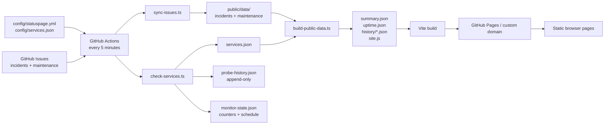
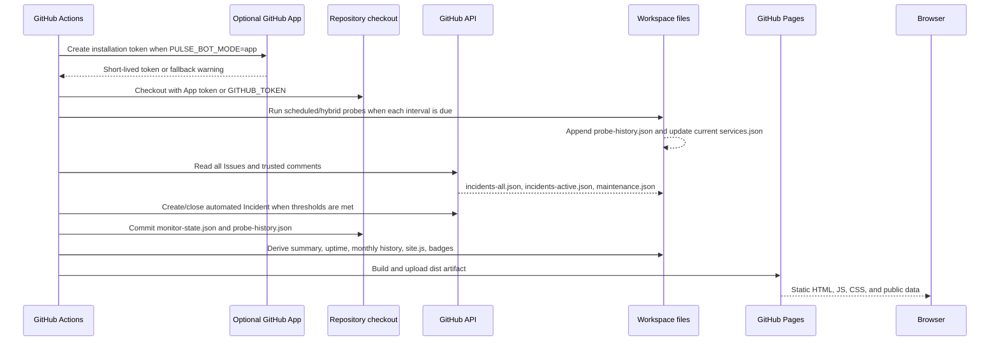
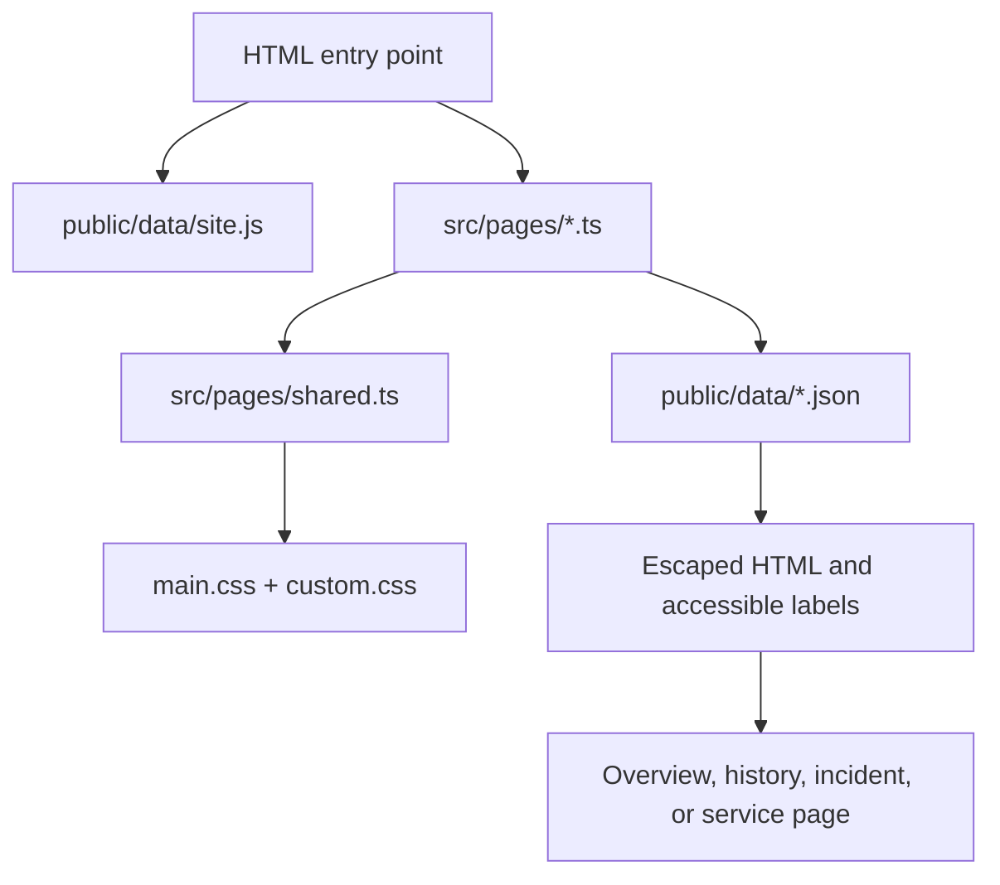

# PulseStatus 架构与运行逻辑

**语言：** [English](../architecture.md) · 简体中文

本文档描述 PulseStatus 如何将仓库配置、GitHub Issues、定时探测和静态资源转化为公开的站点。它是供需要修改数据管道、监控行为、页面或 GitHub Actions workflow 的贡献者使用的运维参考。

## 系统边界

PulseStatus 是一个静态 GitHub Pages 应用。没有应用服务器、数据库、浏览器端 GitHub token、登录机制或运行时的 GitHub API 依赖。



浏览器只读取已发布的文件。它永远没有权限创建 Issue、修改服务或写入提交。

## 完整 workflow 流程

[`.github/workflows/statuspage.yml`](../../.github/workflows/statuspage.yml) 中的 workflow 由推送、每五分钟的定时调度、workflow dispatch 以及相关的 Issue/Discussion 事件触发。



### 逐步说明

1. **选择身份。** 仅当 `PULSE_BOT_MODE=app` 且两个 App 密钥都存在时，workflow 才会尝试使用已配置的 GitHub App。安装缺失或凭据无效会产生警告，并回退到 `GITHUB_TOKEN`。
2. **检出源码。** 所选 token 用于仓库检出和后续的内容推送。
3. **校验代码与配置。** 在任何发布之前，先运行类型检查、测试和 `validate-config`。
4. **探测服务。** `check-services.ts` 在同步 Issues 之前运行，并发检查已到期的 scheduled/hybrid 服务；每次结果在请求完成时记录时间。Manual 服务会无条件跳过。
5. **同步 Issues。** `sync-issues.ts` 下载分页的 Issues，拒绝无效 label，只保留受信任的评论，并写入公开的 incident/maintenance 快照。
6. **发布自动化 Incident。** `auto-publish-incidents.ts` 消费当前的探测结果和持久化的计数器。在配置的故障阈值之后创建一个带标记的 Issue，并在配置的恢复阈值之后关闭它。
7. **关闭已完成的维护。** 当 `issues.autoCloseMaintenance` 启用时，`sync-issues.ts` 会在结束时间之后关闭处于打开状态、未取消的 maintenance Issue。带有 `state/delayed` label 的 Issue 除外：它们保持打开状态，并在计划结束时间之后导出为进行中。
8. **持久化监控状态。** workflow 以 `[skip ci]` 提交计数器文件、服务快照和只追加的探测历史，使状态能在下一次定时运行中保留下来，而不会递归触发 workflow。
9. **构建公开数据。** `build-public-data.ts` 推导汇总状态、Incident 历史、由 Incident 推导的正常运行时间（计划维护窗口不计入停机时间）、服务组配置以及站点品牌数据。
10. **配置 Pages 并构建。** `configure-pages` 提供实际的 base path。Project Pages 使用 `/PulseStatus/`；配置了自定义域名时使用 `/`。
11. **部署。** Pages artifact 被上传并部署。GitHub Pages 在无服务器进程的情况下提供结果。

## 监控状态机

有两条独立的状态轨道：探测调度和 Incident 自动化。

```mermaid
stateDiagram-v2
    [*] --> NotDue
    NotDue --> NotDue: workflow runs before checkIntervalMinutes
    NotDue --> ProbeDue: interval elapsed
    ProbeDue --> Operational: HTTP response is OK
    ProbeDue --> Degraded: HTTP response is non-2xx
    ProbeDue --> Down: timeout, DNS, network, or fetch error
    Operational --> NotDue: append result; reset failures
    Degraded --> NotDue: append result; reset failures
    Down --> NotDue: append result; increment failures

    state "Automatic Incident track" as IncidentTrack {
        Healthy --> Failing: real probe fails
        Failing --> Failing: failure count below threshold
        Failing --> IncidentOpen: failure count reaches failuresToIncident
        IncidentOpen --> IncidentOpen: failures continue
        IncidentOpen --> Recovered: real probe succeeds
        Recovered --> Recovered: success count below recovery threshold
        Recovered --> Healthy: success threshold closes marked Issue
    }
```



### 探测调度规则

- Actions 的调度周期是五分钟，但它不是每个服务的探测频率。
- `monitoring.probeIntervalMinutes` 是默认间隔。
- `service.checkIntervalMinutes` 覆盖默认值。
- 被跳过的服务复用其最近的当前结果，且不写入新的探测记录。
- 一次真实请求会向 `public/data/probe-history.json` 追加一条记录。
- Manual 服务永远不会请求其 `checkUrl`，即使配置了该字段。
- 请求失败记为 `down` 结果；非 2xx 响应记为 `degraded`；成功的 2xx 响应记为 `operational`。

### 自动 Incident 规则

自动化使用如下 HTML 标记：

```html
<!-- pulsestatus-auto:web -->
```

该标记使 Issue 在后续运行中可被发现，并防止同一服务出现重复的 Issue。生成的 Issue 仍是一个普通的 GitHub Issue：维护者应核实影响、补充运维上下文，并判断其严重程度是否恰当。

如果自动发布被禁用，计数器仍然可以安全地持久化，但自动化不会创建或自动关闭 Issue。

## 数据契约与生命周期

### 源配置

| 来源 | 读取者 | 含义 |
| --- | --- | --- |
| `config/statuspage.yml` | 校验器、监控器、数据构建器 | 站点品牌、监控默认值、阈值、label、Issue 策略、服务组、历史和嵌入行为。 |
| `config/services.json` | 校验器、监控器、数据构建器 | 稳定的服务 ID、URL、显示文本、监控模式和间隔覆盖。 |
| GitHub Issue label | `sync-issues.ts` | 发布授权、服务关联、严重程度和 Incident 状态。 |

### 可变的当前快照

这些文件描述当前运行状态，可以重新生成：

| 文件 | 生产者 | 含义 |
| --- | --- | --- |
| `public/data/services.json` | `check-services.ts` | 每个服务的当前状态和最近一次完成的探测。 |
| `public/data/summary.json` | `build-public-data.ts` | 整体当前状态和计数。 |
| `public/data/summary.js` | `build-public-data.ts` | 包含当前汇总的 JavaScript 回退文件。 |
| `public/data/incidents-active.json` | `sync-issues.ts` | 仅有效的进行中 Incident。 |
| `public/data/incidents-all.json` | `sync-issues.ts` | 有效的进行中和已解决的 Incident。 |
| `public/data/maintenance.json` | `sync-issues.ts` | 有效的维护事件及其状态。 |
| `public/data/site.js` | `build-public-data.ts` | 经过净化的站点标识、品牌和服务组配置。 |

### 追加型与历史数据

| 文件 | 写入行为 | 含义 |
| --- | --- | --- |
| `public/data/probe-history.json` | 每次真实探测追加一条记录 | 不可变的 scheduled/hybrid 探测结果。 |
| `public/data/monitor-state.json` | 更新计数器和最近探测元数据 | 用于判断探测是否到期和 Incident 阈值的运维游标。 |
| `public/data/uptime.json` | 重新生成的快照 | 由 Incident 推导的、配置历史窗口内的每日正常运行时间。 |
| `public/data/history-index.json` | 重新生成的索引 | 已解决 Incident 以及已完成或已取消维护的月度归档索引。 |
| `public/data/history/YYYY-MM.json` | 按月生成的文件 | 按 UTC 开始月份分组的已解决 Incident 以及已完成或已取消维护。 |
| `public/feed.xml` | 重新生成的订阅源 | Incident 与维护的 Atom 订阅源（需要 `site.url` 或 `site.companyUrl`）。 |
| `public/maintenance.ics` | 重新生成的订阅源 | 计划维护的 iCalendar 订阅源（同样的 URL 要求）。 |
| `public/sitemap.xml` | 重新生成的索引 | 静态页的站点地图（同样的 URL 要求）。 |
| `STATUS.md` | 重新生成的摘要 | 仓库状态表：每服务的状态、延迟和 uptime，由 workflow 提交。 |

探测历史和由 Incident 推导的正常运行时间是有意不同的：

- **探测历史**回答的是："一次真实的定时请求观察到了什么？"
- **Incident 正常运行时间**回答的是："已发布的 Incident 停机时间与每个 UTC 日重叠了多少？" 计划维护窗口不计入该停机时间。

一个 Manual 服务可以没有任何探测记录，却仍然拥有由 Incident 推导的正常运行时间数据。某天 100% 的 Incident 正常运行时间意味着没有已发布的停机，并不能证明每一分钟都被探测过。

## 前端路由与渲染



| URL | 入口文件 | 主要数据 |
| --- | --- | --- |
| `/` | `index.html` → `src/pages/overview.ts` | summary、active incidents、maintenance、services、uptime |
| `/history.html` | `history.html` → `src/pages/history.ts` | uptime、services、monthly history |
| `/incident.html?number=123` | `incident.html` → `src/pages/incident.ts` | all incidents |
| `/service.html?id=web` | `service.html` → `src/pages/service.ts` | service、uptime、probe history、incidents、maintenance |

`src/pages/shared.ts` 负责公共页头、管理员选择的主题、页脚、日期格式化、状态卡片、服务链接和配置的 favicon。公开的 Issue 和配置文本在进入 DOM 之前都会经过 `escapeHtml` 处理。每个服务组的聚合状态标识由浏览器根据 `services.json` 的成员状态和 `incidents-active.json` 的严重程度推导得出，因此组状态无需修改构建脚本。

## 仓库文件地图

以下列表涵盖项目拥有的每一个源码、配置、页面、数据和文档文件。`node_modules/` 下的依赖和 `dist/` 下的构建输出被有意排除在外。

### 根目录文件

| 文件 | 角色与逻辑 |
| --- | --- |
| `package.json` | 定义包元数据以及全部的开发、校验、同步、监控、数据构建、badge 和测试命令。 |
| `tsconfig.json` | 面向源码、脚本和测试的 TypeScript 编译器设置。 |
| `vite.config.ts` | 声明四个静态 HTML 入口点，并读取 `VITE_BASE_PATH` 以适配 project Pages 或自定义域名。 |
| `index.html` | 概览文档外壳；加载站点品牌数据和概览模块。 |
| `history.html` | 历史文档外壳；加载站点品牌数据和历史模块。 |
| `incident.html` | Incident 详情文档外壳；加载站点品牌数据和 Incident 模块。 |
| `service.html` | 服务详情文档外壳；加载站点品牌数据和服务模块。 |
| `README.md` | 面向用户的安装、配置、截图、发布、故障排除和运维身份指南。 |
| `.gitignore` | 将本地依赖、构建输出和仅开发用的产物排除在提交之外。 |

### 配置

| 文件 | 角色与逻辑 |
| --- | --- |
| `config/statuspage.yml` | 站点标识、favicon、公司/页脚文本、监控默认值、自动 Incident 策略、受信任维护者、历史和嵌入设置的中央 YAML 配置。 |
| `config/services.json` | 服务注册表。稳定的 ID 连接显示卡片、Issue label、探测历史、正常运行时间和服务详情 URL。 |

### GitHub 自动化

| 文件 | 角色与逻辑 |
| --- | --- |
| `.github/workflows/statuspage.yml` | 编排校验、可选的 App token 创建、Issue 同步、服务探测、自动 Incident 操作、状态提交、Pages base path 检测、构建和部署。 |
| `.github/ISSUE_TEMPLATE/incident-report.yml` | 供维护者发布已确认服务 Incident 的结构化表单。 |
| `.github/ISSUE_TEMPLATE/scheduled-maintenance.yml` | 供计划维护窗口使用的结构化表单。 |
| `.github/ISSUE_TEMPLATE/bug-report.yml` | 普通的仓库 bug 表单；不会作为服务 Incident 发布。 |

### 运行时代码

| 文件 | 角色与逻辑 |
| --- | --- |
| `src/types/status.ts` | Incident、服务、汇总、维护、站点配置、监控状态、探测结果和正常运行时间的共享契约。 |
| `src/i18n.ts` | 英文/中文字符串、区域设置选择以及状态标签翻译。 |
| `src/utils/status.ts` | Incident 排序、按月分组、整体状态推导、组状态聚合、汇总构建、每日正常运行时间计算和 HTML 转义。 |
| `src/data/issues.ts` | GitHub Issue label 校验、活跃状态计算、安全摘要、受信任评论过滤、时间线构建和 Incident 转换。 |
| `src/data/maintenance.ts` | 维护时间戳解析、时间窗口状态计算和 Issue 转换。 |
| `src/data/monitor.ts` | 供测试和监控行为使用的纯监控阈值转换逻辑。 |
| `src/pages/shared.ts` | 共享布局、配置的品牌、导航、样式、日期格式化、服务卡片、Incident 卡片和状态样式类。 |
| `src/pages/overview.ts` | 加载当前汇总、Incident、服务、维护和正常运行时间；按严重程度排序，渲染状态横幅、90 天正常运行时间条和按配置布局（`standard` Cloudflare 风格行或圆角 `fused` 系统面板）的服务目录。 |
| `src/pages/history.ts` | 加载正常运行时间并懒加载已解决 Incident 和已完成维护的月度归档。 |
| `src/pages/incident.ts` | 通过查询字符串编号查找一个已发布的 Incident 并渲染其时间线。 |
| `src/pages/service.ts` | 通过 ID 查找一个服务并渲染正常运行时间、探测历史、相关 Incident 和维护。 |
| `src/styles/main.css` | 内置的响应式布局、组件样式、语义化状态颜色、主题和可访问性状态。 |
| `src/styles/custom.css` | 在内置样式表之后加载的、由仓库持有的 CSS 覆盖层。 |
| `src/vite-env.d.ts` | Vite 类型和全局 `window.PulseStatusConfig` 声明。 |

### 构建与同步脚本

| 文件 | 角色与逻辑 |
| --- | --- |
| `scripts/validate-config.ts` | 在发布之前校验必需的站点、监控、历史、自动 Incident、用户名、严重程度和间隔设置。 |
| `scripts/sync-issues.ts` | 调用 GitHub 分页的 Issues 和评论 API，转换有效记录，并写入 Incident/maintenance 快照。 |
| `scripts/check-services.ts` | 应用按服务的调度，执行有边界的 fetch，写入当前服务状态，并追加真实的探测结果。 |
| `scripts/auto-publish-incidents.ts` | 读取探测状态，在连续失败之后创建一个带标记的自动化 Issue，并在连续恢复之后关闭它。 |
| `scripts/build-public-data.ts` | 从同步的数据推导汇总、月度历史、90 天 Incident 正常运行时间、site.js 和 summary.js。 |
| `scripts/generate-badges.ts` | 从公开汇总数据生成 SVG 状态、Incident 和按服务的 badge。 |
| `scripts/lock-incidents.ts` | 对符合条件的 GitHub Incident 应用配置的锁定行为。 |
| `scripts/sync-discussions.ts` | 启用时同步配置的受信任 Discussion 公告。 |

### 测试

| 文件 | 角色与逻辑 |
| --- | --- |
| `tests/status.test.ts` | 覆盖 Issue 解析、受信任评论、Incident 活跃状态、维护边界、监控阈值、汇总状态和重叠的每日正常运行时间。 |

### 公共资源与生成文件

| 路径 | 角色与逻辑 |
| --- | --- |
| `public/favicon.png` | 已发布站点使用的默认浏览器 favicon。 |
| `public/favicon.svg` | 为品牌修改保留的原始矢量 favicon 源文件。 |
| `public/badges/*.svg` | 生成的状态和服务 badge 资源。 |
| `public/embed.js` | 供外部网站使用的可选只读嵌入脚本。 |
| `public/embed.d.ts` | 与嵌入集成关联的类型声明。 |
| `public/data/*.json` | 数据生命周期一节中描述的、浏览器可读取的快照。 |
| `public/data/history/*.json` | 从已解决 Incident 生成的月度 Incident 归档文件。 |

### 文档

| 文件 | 角色与逻辑 |
| --- | --- |
| `docs/architecture.md` | 本运行时、数据流、状态机和文件职责参考。 |
| `docs/configuration.md` | 完整的 YAML/JSON 配置、服务、探测、Incident、维护和 workflow 参考。 |
| `docs/customization.md` | 品牌、favicon、CSS、主题、字体、可访问性和发布定制指南。 |
| `docs/github-app.md` | 可选的 GitHub App 身份设置、权限、bot 提交身份、回退和轮换指南。 |
| `docs/embed.md` | 外部嵌入属性、数据行为和故障排除。 |
| `docs/assets/*.png` | README 使用的英文截图；它们仅供文档使用。 |

## 修改指南

使用最相关的最小路径：

- **添加服务：** 编辑 `config/services.json`，添加匹配的 GitHub label，运行校验，如果部署仍使用显式列表，还要更新 workflow 中的 `PULSE_SERVICES`。
- **修改探测频率：** 为单个服务编辑 `checkIntervalMinutes`，或为默认值编辑 `monitoring.probeIntervalMinutes`。
- **修改自动 Incident 行为：** 编辑 `config/statuspage.yml` 中的 monitoring 和 issues 小节；不要手动修改 probe-history 记录。
- **修改品牌：** 编辑 site 小节，在 `public/` 下添加资源，并使用 `src/styles/custom.css` 进行视觉覆盖。
- **修改页面：** 编辑对应的 `src/pages/*.ts` 模块，并复用 `src/pages/shared.ts` 中的辅助函数。
- **修改已发布的数据：** 修改生成它的脚本，并更新 `src/types/status.ts` 中对应的类型。
- **修改部署：** 编辑 `.github/workflows/statuspage.yml`，然后解析 YAML 并运行生产构建。

在发布任何修改之前：

```bash
npm run validate-config
npm run typecheck
npm test
npm run build
```
